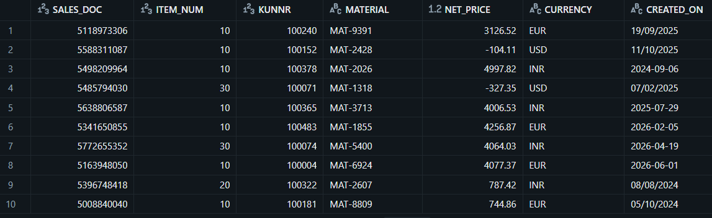
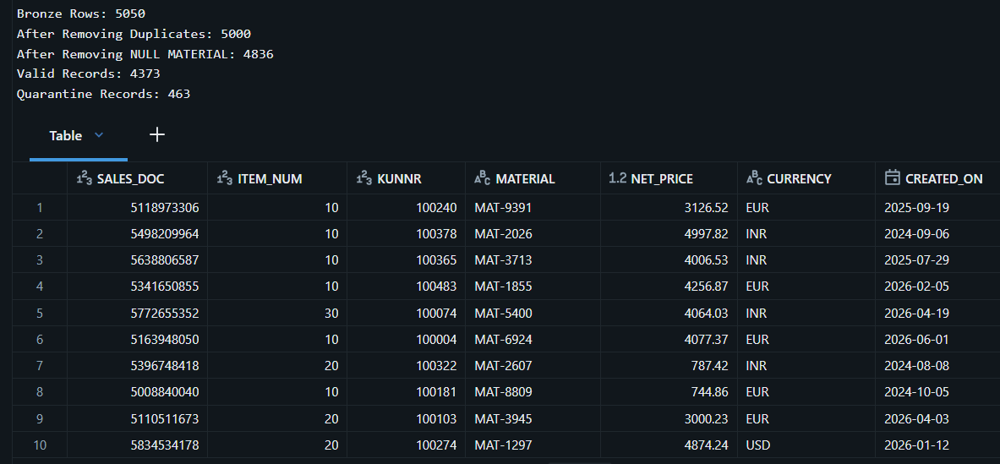
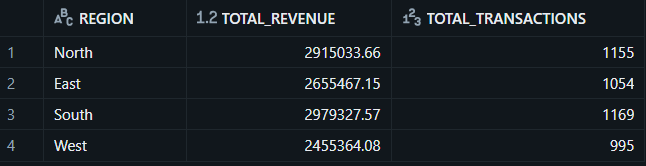
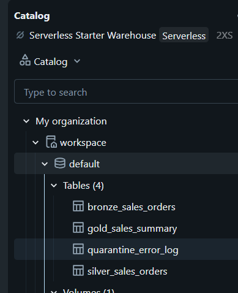
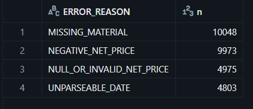
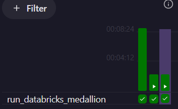
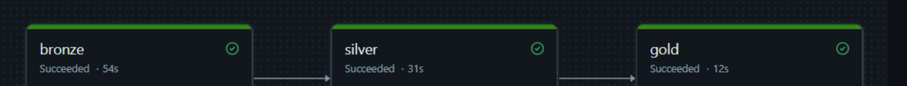

# Legacy SAP Migration Engine

## Project Overview

This project simulates the migration of a legacy SAP ETL pipeline to a modern cloud Lakehouse architecture using Databricks and PySpark.

The pipeline follows the Medallion Architecture (Bronze, Silver, Gold) to ingest, clean, transform, and aggregate SAP sales data for analytics.

---

## Architecture

```
Airflow (daily trigger)
        │
        ▼
SAP CSV Files
        │
        ▼
 Databricks Volume
        │
        ▼
 Bronze Layer
 (Raw Delta Table)
        │
        ▼
 Silver Layer
──────────────────────────────
✓ Remove Duplicates
✓ Remove Null Values
✓ Standardize Dates
✓ Quarantine Invalid Records
──────────────────────────────
        │
        ▼
 Broadcast Join
(Customer Master)
        │
        ▼
 Gold Layer
──────────────────────────────
Revenue by Region
Transaction Count
──────────────────────────────
        │
        ▼
 Business Analytics
```

---
## Sample Outputs
### Bronze Layer



### Silver Layer



### Gold Layer



### Databricks Catalog



### Quarantine Summary



## Tech Stack

- Python
- PySpark
- Databricks
- Delta Lake
- Unity Catalog
- Faker
- Pandas

---

## Project Structure

```
Legacy-SAP-Migration-Engine
│
├── airflow/
│   └── dags/
│       └── sap_medallion_dag.py
├── data_generator/
├── datasets/
├── databricks/
│   ├── 01_Bronze_Layer.py
│   ├── 02_Silver_Layer.py
│   └── 03_Gold_Layer.py
│   └── sap_pipeline_v2.py
|   |__gold_star_schema.py
|
├── images/
├── README.md
├── requirements.txt
└── .gitignore
```

---

## Bronze Layer

- Read SAP CSV files
- Store raw data in Delta tables

---

## Silver Layer

- Deduplicate on the business key
- Parse four date formats (dd/MM/yyyy, yyyy-MM-dd, yyyyMMdd, dd.MM.yyyy)
- Invalid rows go to quarantine_error_log with an ERROR_REASON
  (MISSING_MATERIAL, NULL_OR_INVALID_NET_PRICE, NEGATIVE_NET_PRICE, UNPARSEABLE_DATE)
- Row-count check: bronze = silver + quarantine, or the run fails
- Idempotent writes (replaceWhere): reruns never duplicate data

---

## Gold Layer

- Broadcast Join with Customer Master
- Revenue aggregation by Region
- Transaction summary
- Delta optimization

---

## Orchestration

Airflow (run locally with the Astro CLI and Docker) triggers the Databricks Job
`sap_medallion` daily through the Databricks provider. The job runs bronze, silver,
and gold as separate tasks. The run date is passed from Airflow ({{ ds }}) and writes
are idempotent (replaceWhere), so retries and reruns never duplicate data.

### Airflow DAG Run



### Databricks Job Run



---

## Dimensional Model (Star Schema)

- fact_sales: one row per order (keys + NET_PRICE)
- dim_customer, dim_material, dim_date
- Orders whose customer is missing from the master point to an UNKNOWN row,
  so no revenue is dropped
- Validation: fact_sales row count equals silver, and revenue by region matches the gold summary
- 6 business queries (monthly revenue, top customers, top materials per region,
  running total, month-over-month growth) in sql/star_schema_queries.sql

---

## Test Data

- data_generator/generate_sap_data_small.py: small dataset (Faker + Pandas), for local testing
- data_generator/generate_sap_data_spark.py: 1M orders and 5K customers, run in Databricks,
  with injected defects: duplicates, negative prices, missing materials,
  mixed date formats, and orphan customers

---

## Features

- Medallion Architecture
- Delta Lake
- Data Quality Validation
- Broadcast Join
- Business Aggregations
- Production-style ETL Pipeline

---

## Future Improvements

- Unit tests and GitHub Actions CI
- Power BI Dashboard
